# RecoCon -レコードコンサートの座席予約システム-

---

## 〈RecoConのアプリケーション概要〉

RecoConは、レコードコンサートの座席予約を行うWebアプリケーションです。

実際に学生時代に開催したレコードコンサートを題材として、当時掲示板で告知していた訴求チラシに加えて予約の便宜向上を狙ってWeb予約システムを導入することを想定して制作しました。

このアプリケーションは、利用者とデータベースの関係を構想して実装制作されています。
利用者は、ブラウザを用いて利用者向けページを閲覧し、データベースの情報を利用者権限に応じて参照・更新・削除し、たとえばアカウントの作成や座席の予約をすることができます。
管理者とデータベースの関係は構想段階ですが、
管理者も、ブラウザを用いて管理者向けページを閲覧し、データベースの情報を管理者権限に応じて参照・更新・削除し、たとえば公演内容を管理し内容を利用者へ告知することができます。


利用者に対して以下の機能を提供します。

【トップページ・RecoConについて・お知らせ・アクセス】
- 当コンサート情報の閲覧。公演日・内容と、AJAXを用いたその詳細表示やページネーション。
- トップページ下部、公演内容に関するカルーセル。
- アクセスページでのiFrameによる地図を用いた会場情報の表示。

【予約券・当日券の購入】
- 登録会員・ゲストユーザーによる座席予約機能。AJAXを使用したグラフィカルな座席選択画面。
- 情報の入力・入力値のバリデーション機能。
- 予約確定および予約内容のメール通知機能。

【メンバーズクラブ】
- 会員登録・更新・削除およびログイン・ログアウト。
- 情報の入力・入力値のバリデーション機能。
- 登録確定および登録内容のメール通知機能。

【感想要望】
- 感想要望入力・送信機能。
- 入力文字数カウント機能。


管理者に対して以下の機能を提供します。

- 今後構築予定です。公演情報の登録・更新・削除。ユーザー・スタッフの登録・更新・削除。など。

---

## 〈初版からの改訂内容〉

初版のソースコードを見直し、認証・認可、座席予約、メール通知などの処理を中心に改修しました。また、公開環境での運用を想定し、HTTPSへの対応と動作検証を行いました。


### 【通信プロトコル】HTTPからHTTPSへ。

ロリポップレンタルサーバーでHTTPSを使用するため、独自ドメインを取得しSSL/TLSを設定しました。これによってブラウザとWebサーバー間の通信が暗号化され、万が一盗聴されても情報が暗号化されているため解読を困難にすることができます。
.htaccessファイルにより、強制リダイレクト（HTTPの場合はHTTPSへ）の設定も行いました。こんにちではHTTPによる通信は危険とされ、強制的にリダイレクトすることにより、必ずHTTPSによる暗号通信を行うようにしました。

ロリポップレンタルサーバーの.htaccessにて、
```apache
RewriteEngine On

RewriteCond %{HTTPS} !=on
RewriteRule ^ https://%{HTTP_HOST}%{REQUEST_URI} [R=301,L]
```

### 【認証・認可】パスワードのハッシュ化

データベースには、パスワードの平文を保存せず、ハッシュ化した値を保存しています。ログイン時には password_verify() を使用して、入力されたパスワードと保存済みのハッシュ値を照合します今回の改訂では、この運用方法はそのままにしてパスワードのハッシュアルゴリズムをArgon2idへ変更しました。

Argon2idでは、ハッシュ計算を並列実行する際に計算能力だけでなくメモリ資源も必要になるアルゴリズムです。GPUなどを使った高速の並列計算に対抗することができます。総当たり攻撃に必要な計算資源を増やすことを目的に採用しました。弱点としては、正規の利用者の会員登録時やログイン時にもやや負荷がかかってしまうことです。なお、もとのbcryptが脆弱だという意味ではなく、bcryptも安全なアルゴリズムと言われています。

```php
// 初版
password_hash($pasword, PASSWORD_BCRYPT, ['cost'=>14]);

// 改訂版
password_hash($pasword, PASSWORD_ARGON2ID);
```

### 【認証・認可】ログイン状態の管理とアクセス制御

RecoConでは、PHPのセッションを使用してログイン状態を管理しています。

初版のコードを見直し、認証が必要なページや処理に対して、サーバー側でログイン状態を確認する仕組みを追加しました（認証）。さらに、ログイン状態の確認だけでなく、利用者が情報や機能を操作する権限を持っているかを確認するようにしました（認可）。

例えば、会員情報の更新処理では、リクエストメソッドの確認、セッションによるログイン状態の確認、CSRFトークンの検証、更新対象の会員IDとログイン中の会員IDの照合を行っています。未認証の場合はHTTP 401、操作対象の会員IDが一致しない場合やトークンの異常を検知した場合はHTTP 403を返し、exitによりデータベースの更新処理に進まないようにしました。

これにより、URLを直接指定した場合や、ログアウト後に以前のページへアクセスした場合リクエストを書き換えた場合でも、処理を実行できず情報が保護されるようにしました。

```php
// リクエストメソッドの検証。
if (($_SERVER['REQUEST_METHOD'] ?? '') !== 'POST'){
   header('Allow: POST');
   http_response_code(405);
   exit('POSTで送信してください。');
}

// ログイン状態を検証する。
if (empty($_SESSION['User']['u_id']) || empty($_SESSION['User']['u_input_id'])){
   http_response_code(401);
   exit('ログインし直してください。');
}

// CSRF対策。トークンの検証。
if (!recoConCsrfValid($_POST['token'] ?? null)){
   http_response_code(403);
   exit('正規画面からご利用ください。');
}

// 認可検証。ログインユーザー当人の情報を操作しようとしているか。
if (!isset($_POST['MClub_updateAcct_U_Id']) || !is_scalar($_POST['MClub_updateAcct_U_Id']) ||
    !ctype_digit((string)$_POST['MClub_updateAcct_U_Id']) ||
    (int)$_POST['MClub_updateAcct_U_Id'] !== (int)$_SESSION['User']['u_id']){
   http_response_code(403);
   exit('会員情報の更新対象が一致しません。');
}
```

### 【認証・認可】ログイン試行回数の制限

パスワードの総当たり攻撃への対策として、ログイン失敗履歴をMySQLのデータベースで管理する仕組みを追加実装しました。

ログインIDごとに直近15分間で5回、IPアドレスごとに30回の失敗を上限とし、上限に達していた場合は認証処理を制限してHTTPステータスコード429を返すようにしました。

以下は、ログイン試行失敗が上限に達しているときに「limited」を返す recoconLoginWithLimit() の一部抜粋です。認証に失敗した場合は履歴を追加し、以降のログイン試行時に直近15分間の失敗回数を再集計します。ログインIDのハッシュ値を保存し、同一IDでのログイン試行回数の集計に使用しました。また、関数内では、複数のログインリクエストが同時に実行された場合に、失敗回数の判定と記録の不整合を防ぐため、MySQLのGET_LOCK()で排他制御も行っています。

```php
// 直近15分間でのID別のログイン試行失敗回数を取得し $idFailures に格納する。
$stmt = $pdo->prepare(
    'SELECT COUNT(*) FROM Login_Failed
     WHERE login_id_hash = UNHEX(:idHash)
     AND datetime_at >= NOW() - INTERVAL 15 MINUTE'
);
$stmt->execute([':idHash' => $idHash]);
$idFailures = (int)$stmt->fetchColumn();
$stmt->closeCursor();

// IP別の失敗回数も同様に取得し $ipFailures に格納する。

// 上限に達していた場合は認証処理を制限。
if ($idFailures >= 5 || $ipFailures >= 30) {
    return 'limited';
}
```

### 【セキュリティ】入力値の検証

会員登録や座席予約などの入力処理について、入力値の検証方法を見直しました。

入力値の検証には正規表現を使用し、各入力項目の検証ルールを自作のregex()関数で共通管理しています。

座席予約では、ゲストユーザーの入力情報をデータベースに登録する前に、validateGuestInput()で再検証します。この関数では、入力値の型・文字数・文字コード・制御文字・入力形式をサーバー側で検証し、検証に失敗した場合はfalseを返します。たとえば、falseが返された場合、呼び出し元で予約確定処理の進行を中止します。

以下は、正規表現の共通関数regex()を使用したサーバー側の入力値検証関数validateGuestInput()。

```php
// validate_guest.php（抜粋）
function validateGuestInput($data): bool
{
    if (!is_array($data)) {
        return false;
    }

    $r = regex();

    $rules = [
        'Name' => [$r['Name'], 50],   // $r['Name']はNameの正規表現。
        'Age'  => [$r['Age'], 3],     // $r['Age']はAgeの正規表現。
        // その他の項目は省略
    ];

    foreach ($rules as $key => [$reg, $max]) {
        if (!isset($data[$key]) || !is_string($data[$key])) {
            return false;
        }

        // バイト長・UTF-8・文字数・制御文字の検証は省略

        if (preg_match($reg, $data[$key]) !== 1) {
            return false;
        }
    }

    return true;
}
```

### 【座席予約】予約情報の管理と重複予約の防止

初版の予約処理を見直し、同じ公演・同じ座席に対して複数の予約が成立しないよう、データベース側の処理を改善しました。

予約処理にはトランザクションを使用し、予約可能な座席の判定と予約情報の更新を一連の処理として扱うようにしました。

また、複数の利用者が同時に予約操作を行う場合を想定し、未予約の座席だけを更新するSQLと更新件数の確認によって、重複予約を防止しています。

```php
try {
    $PDO->beginTransaction();

    // 予約対象の座席を更新
    $PDOState = $PDO->prepare(
        'UPDATE Ticket_Sale
         SET sale=:sale, u_id=:u_id, g_id=:g_id
         WHERE cs_id=:cs_id AND seat=:seat AND sale=0'   //sale=1は販売済。sale=0は未販売。
    );

    // bindValue()によるパラメータ設定は省略

    $PDOState->execute();

    if ($PDOState->rowCount() !== 1) {
        throw new RuntimeException('この座席はすでに予約されています。');
    }

    // その他の予約処理は省略

    $PDO->commit();

} catch (Throwable $e) {
    if ($PDO->inTransaction()) {
        $PDO->rollback();
    }
}
```

### 【メール通知機能】メール通知機能の修理。

予約が確定した場合、登録されたメールアドレスへ公演日時・座席番号・曲目などを記載した確認メールを送信します。

メール送信処理は予約情報のデータベース登録が完了した後に実行し、送信に失敗しても確定済みの予約が取り消されないようにしました。

また、送信元のメールアドレスは環境変数で管理し、送信前に宛先・件名などの値を検証することで、メールヘッダーインジェクション対策を行いました。

```php
// function_sendRecoconMail.php（抜粋）
function sendRecoconMail(
    string $to,
    string $subject,
    string $body
): bool {

    $from = getenv('RECOCON_MAIL_FROM');

    // 送信元の検証は省略

    // 宛先の検証
    if (
        strlen($to) > 254 ||
        !filter_var($to, FILTER_VALIDATE_EMAIL) ||
        strpbrk($to, "\r\n\0,<>") !== false
    ) {
        return false;
    }

    // 件名へのヘッダー注入防止
    if (strpbrk($subject, "\r\n\0") !== false) {
        return false;
    }

    // メール送信処理は省略
}
```

---

## 〈初版の構成〉

初版ではMacbookPro上で既存のXAMPP環境を用いて開発を行い、ロリポップレンタルサーバーへアップロードしてHTTPで公開していました。

## 〈改訂版の構成〉

```mermaid
flowchart TB
    Mint["Linux Mint<br/>開発・管理用ホスト"]
    Share["同一アプリケーションコードを使用<br/>PHP / JavaScript / CSS"]

    Mint --> Share

    subgraph DEV["開発環境：Ubuntu Server / Docker Compose"]
        direction TB
        DevApp["RecoCon<br/>アプリケーションコード"]
        DevConfig["環境設定<br/>.env → compose.yaml"]
        DevWeb["webコンテナ<br/>Apache 2.4 + PHP 8.3"]
        DevDB[("dbコンテナ<br/>MySQL 8.0")]
        DevMail["mailpitコンテナ<br/>Mailpit"]

        DevConfig -.->|"環境変数"| DevWeb
        DevApp --- DevWeb
        DevWeb -->|"PDO"| DevDB
        DevWeb -->|"msmtp"| DevMail
    end

    subgraph PROD["本番環境：ロリポップ"]
        direction TB
        ProdApp["RecoCon<br/>アプリケーションコード"]
        ProdConfig["環境設定<br/>.htaccess → PHPのgetenv()"]
        ProdWeb["Nginx + Apache + PHP 8.3"]
        ProdDB[("MySQL 8.0")]
        ProdMail["Postfix"]

        ProdConfig -.->|"環境変数"| ProdWeb
        ProdApp --- ProdWeb
        ProdWeb -->|"PDO"| ProdDB
        ProdWeb -->|"メール送信"| ProdMail
    end

    Share -->|"開発環境で使用"| DevApp
    Share -->|"本番環境でも使用"| ProdApp
```



---

## 〈改訂版のアプリケーションの技術（開発環境）〉

| 分類             | 技術                                    | 用途                                                 |
| ---------------- | --------------------------------------- | ---------------------------------------------------- |
| Backend          | PHP 8.3                                 | 予約処理、会員管理、認証・認可、DB操作               |
| Frontend         | HTML / CSS / JavaScript / AJAX          | 画面表示、操作処理、非同期通信                       |
| Authentication　 | PHPセッション / 自作認証処理 / Argon2id | ログイン状態管理、アクセス制御、パスワードハッシュ化 |
| Web Server       | Apache 2.4                              | HTTPリクエストの受付、PHPの実行                      |
| Database         | MySQL 8.0 / PDO                         | データの保存、SQLの実行                              |
| Mail             | msmtp / Mailpit                         | 開発環境でのメール送信テスト                         |
| Container        | Docker / Docker Compose                 | Web・DB・メール環境の構築と管理                      |
| OS               | Linux Mint / Ubuntu Server              | ホスト環境・Docker実行環境                           |
| Virtualization   | VirtualBox                              | Ubuntu Serverの仮想環境                              |
| Configuration    | .env / compose.yaml                     | 開発環境の設定、コンテナの構成                       |

---

## 〈Dockerによる開発環境〉

RecoConの本番環境には、ロリポップのレンタルサーバーを使用しています。

開発にあたり、まず本番サーバーのWebサーバー、PHP、データベースの構成を調査しました。ローカルの開発環境でもできる限り本番に近い条件で動作確認できるよう、調査の結果をもとにそれぞれDocker Composeを使用して開発環境を構築しました。

WebサーバーにはApache、アプリケーションの実行にはPHP、データベースにはMySQLを採用しています。

また、会員登録やチケット購入時のメール通知を安全に検証するため、Mailpitを導入しました。開発環境ではmsmtpクライアントメーリングプログラムを経由してMailpitにメールを送信し、外部への実配送を行わずにローカル開発環境で内容を確認できるようにしました。

なお、本番環境のレンタルサーバーと開発環境のDockerコンテナでは実行環境や設定に違いがあるため、完全な同一環境ではありません。環境依存の設定をアプリケーションのコードから分離することで、本番環境と開発環境でのアプリケーションコードの共通化を図りました。

#### 本番環境と開発環境の比較表

| 項目                   | 本番環境                            | 開発環境                                     |
| ---------------------- | ----------------------------------- | -------------------------------------------- |
| Webサーバー            | Nginx + Apache 2.4.x                | Apache 2.4.69                                |
| PHP                    | PHP 8.3（モジュール版）             | PHP 8.3.36（Apacheモジュール版）             |
| データベース           | MySQL 8.0                           | MySQL 8.0.46                                 |
| メール                 | Postfix                             | msmtp + mailpit v1.30.7                      |
| 実行環境               | Ubuntu（ロリポップ共有サーバー）    | Ubuntu Server（VirtualBox）＋ Docker Compose |

---

### 〈DockerのDockerfileでの構築内容と意図。webコンテナ・mailpitコンテナの設定〉

本番環境の PHP 8.3（モジュール版）に合わせるため、開発環境のベースイメージには PHP 8.3.36（Apache版）を使用しました。

アプリケーションに必要な pdo_mysql、mbstring を導入し、同様にApacheの rewrite、headers モジュールを有効化しました。

PHPの設定を php-dev.ini、Apacheの追加の設定を apache-recocon.conf に分離してDockerfileから読み込むようにしました。

メール送信では、PHPの sendmail_path にmsmtpを設定し、msmtp経由でMailpitへ配送することで、外部への誤送信を防いで安全にメール通知機能を検証できるようにしました。

---

### 〈Docker Composeのcompose.yamlでのコンテナの管理〉

開発環境では、Docker Composeを使用して、Webサーバー、データベース、メール環境の3つのサービスを管理しています。

- **web**：Apache HTTP ServerとPHPを実行するコンテナ。Dockerfileを使用してイメージをビルドします。
- **db**：MySQLを実行するコンテナ。アプリケーションのデータを管理します。
- **mailpit**：開発環境で送信されたメールを受信・確認するためのコンテナ。外部への配送を行わずにローカルの開発環境内でメール通知機能を検証できます。

#### ボリュームの設定

Webコンテナにはバインドマウント ./app:/var/www/html を設定し、ホスト側でのアプリケーションのソースコードをコンテナ側とも共有しました。ホスト側でのソースコードの変更等は同時にコンテナの内容にも反映されます。

データベースには名前付きボリューム recocon_db_data を使用し、MySQLのデータ保存先ディレクトリ /var/lib/mysql を永続化しています。これにより、コンテナを再作成してもデータベースの情報を維持できます。

#### 環境変数の設定

compose.yamlにおいて、環境設定ファイル.envの情報であるたとえばデータベース接続情報などを、Docker Composeの環境変数として定義し.envファイルから読み込むよう設定しました。それによりアプリケーションから環境依存部分を分離しました。こうすることによって、アプリケーションコードを開発環境と本番環境で同じものにすることができるようになりコードの見通しがよくなります。

#### ネットワークの設定

webコンテナからデータベースへの接続には、Docker Composeのサービス名「db」を使用しDocker Compose内のDNSを利用しました。

また、webコンテナとmailpitコンテナのホスト側公開ポートは「127.0.0.1」にバインドしました。たとえば、「http://127.0.0.1:8088」をローカルホストのブラウザから見に行くと、webコンテナのApacheが待ち受けるポート80に接続し、apache.confに設定したindexファイルを実行しページを見ることができます。

データベースMySQLのポートはホスト側に公開しない設定にしました（ports:を記述しませんでした）。

---

## 今後の展開

今後は、座席予約機能の操作性向上と、アプリケーションの保守性・運用性の改善を進める予定です。

### 座席予約状況のリアルタイム更新

現在の座席選択画面では、画面表示時にデータベースから予約状況を取得しています。

今後はAJAXによる定期的なポーリング処理を追加し、他の利用者による予約状況を画面に反映できるようにします。

また、選択中の座席が他の利用者によって予約された場合には、該当座席の選択を解除してグレーアウトさせたうえ再選択を促すメッセージを表示するなど、利用者の操作状態を維持しながら座席の予約状況を半リアルタイムに更新する仕組みを検討しています。

### 保守性・運用性の向上

入力検証や画面処理の共通化、コードの整理を進め、機能の追加や修正を行いやすい開発コードへの改善を進めます。

また、開発環境と本番環境の設定管理を継続的に見直し、デプロイ作業の効率化を図ります。

---

## 〈セットアップ方法〉

本環境は、Ubuntu Server上のDocker Composeに環境を構築します。

### 1. リポジトリの取得

```bash
git clone https://github.com/hiokakko-eng/RecoCon.git
cd RecoCon
```

### 2. 環境設定
設定ファイルを、.env.exampleファイルから作成します。.env.example をコピーして .env を作成してください。

```bash
cp .env.example .env
```

作成した.envにDB接続情報を設定します。DB_PASSWORD と DB_ROOT_PASSWORD を、それぞれ異なる任意のパスワードに変更してください。その他の設定値は、通常は変更する必要はありません。メール送信には開発用のMailpitを使用するため、外部メールサーバーの設定も不要です。

```bash
# .env（抜粋）
DB_PASSWORD=ここに任意の強いパスワードを指定してください。
DB_ROOT_PASSWORD=ここに別の強いパスワードを指定してください。
```

### 3. Dockerコンテナの起動

```bash
docker compose up -d --build
```

### 4. データベースの初期化

初回起動時、MySQLコンテナが以下のSQLファイルを自動実行し、テーブルとサンプルデータを作成します。

- `docker/mysql/init/01-recocon-schema.sql`：テーブル定義
- `docker/mysql/init/02-recocon-seed.sql`：サンプルデータ

※ SQLファイルはデータベースの初回作成時にのみ自動実行されます。

### 5. 動作確認

ブラウザから以下のURLにアクセスしてください。

**RecoCon**

```text
http://127.0.0.1:8088/RecoCon_TOP_XAMPP.php
```

**Mailpit（開発用メール確認画面）**

```text
http://127.0.0.1:8025
```

※ 上記URLはDockerを起動したマシン上からアクセスする場合のものです。別のマシンからアクセスする場合は、SSHポートフォワーディングなどを利用してください。

Mailpitでは、会員登録やチケット予約時に送信されるメールを確認できます。開発環境から外部へのメール送信は行いません。

### 6. コンテナの停止

```bash
docker compose down
```

※ データベースのデータを保持するため、通常の停止では `-v` オプションを付けないでください。
